# SIPALA — Sistem Pengaduan Lapangan

Kanal resmi pengaduan masyarakat daerah: sampaikan laporan, pantau sampai tuntas.

---

## Masalah

- **Pengaduan sulit disampaikan.** Warga tidak tahu harus melapor ke instansi mana, dan
  kanal yang tersedia tersebar (datang langsung, telepon, media sosial) sehingga laporan
  mudah hilang atau tidak tercatat.
- **Tidak ada kepastian tindak lanjut.** Setelah melapor, warga umumnya tidak mendapat
  informasi apakah laporannya diterima, sedang diproses, atau sudah selesai.
- **Penanganan tidak terkoordinasi.** Pengaduan yang masuk sering tidak diteruskan ke
  instansi yang berwenang, sehingga terjadi saling tunggu dan penanganan berlarut-larut.
- **Masalah lapangan tidak terpetakan.** Pemerintah daerah sulit melihat sebaran dan pola
  masalah di wilayahnya, sehingga pengambilan keputusan kurang berbasis data.
- **Riwayat penanganan tidak terdokumentasi.** Sulit mengevaluasi kinerja layanan karena
  catatan aduan dan tindak lanjutnya tidak terpusat.

## Tujuan

- Menyediakan **satu kanal pengaduan resmi** yang mudah diakses warga kapan saja.
- Memastikan setiap pengaduan **tercatat, diteruskan ke instansi yang tepat, dan dipantau
  hingga tuntas**.
- Memberi **transparansi status** kepada pelapor melalui kode tiket dan linimasa
  penanganan.
- Membantu pemerintah daerah **memetakan sebaran masalah** dan mengevaluasi kinerja
  layanan daerah secara berkelanjutan.
- Menjaga **privasi pelapor** dan menyediakan jalur pelaporan yang aman.

## Hasil

**Bagi masyarakat**
- Mendaftar mandiri dan mengirim pengaduan lengkap dengan **titik lokasi di peta** serta
  **foto bukti**.
- Memilih **mode anonim** bila tidak ingin identitasnya ditampilkan.
- Memantau **linimasa status** pengaduan dan membaca tanggapan petugas.
- Menanggapi, membatalkan selama belum selesai, dan **memberi penilaian pelayanan**.
- **Melacak status aduan hanya dengan kode tiket**, tanpa perlu memiliki akun.

**Bagi instansi daerah (Dinas)**
- Menerima pengaduan yang **sesuai kewenangannya** pada dasbor instansi.
- Menindaklanjuti melalui **alur status yang jelas dan terkontrol**, disertai tanggapan
  resmi kepada pelapor.
- Mengunggah **foto bukti penyelesaian** sebagai dokumentasi.
- Melihat sebaran pengaduan instansinya di peta.

**Bagi administrator**
- Mengelola **akun pengguna, instansi, dan kategori pengaduan**.
- Memantau **seluruh pengaduan**, mengubah status, dan **mendisposisikan** aduan ke
  instansi yang lebih tepat.
- Melihat **peta sebaran seluruh aduan** dan **laporan rekapitulasi** yang dapat diekspor.
- Menelusuri **jejak aktivitas** pengelolaan sistem.

**Bagi publik**
- Beranda dengan **statistik ringkas** dan aduan terbaru (identitas pelapor anonim tidak
  ditampilkan).
- Halaman **panduan** penggunaan dan **kebijakan privasi**.

**Manfaat yang diharapkan**
- Layanan pengaduan yang **transparan, akuntabel, dan terdokumentasi**.
- Penanganan yang lebih cepat karena pengaduan langsung diarahkan ke instansi berwenang.
- Data sebaran masalah sebagai **dasar pengambilan keputusan** dan perbaikan layanan.

---

## Tangkapan Layar

Selengkapnya di [`docs/screenshots/`](docs/screenshots/).

| Publik | |
| --- | --- |
| 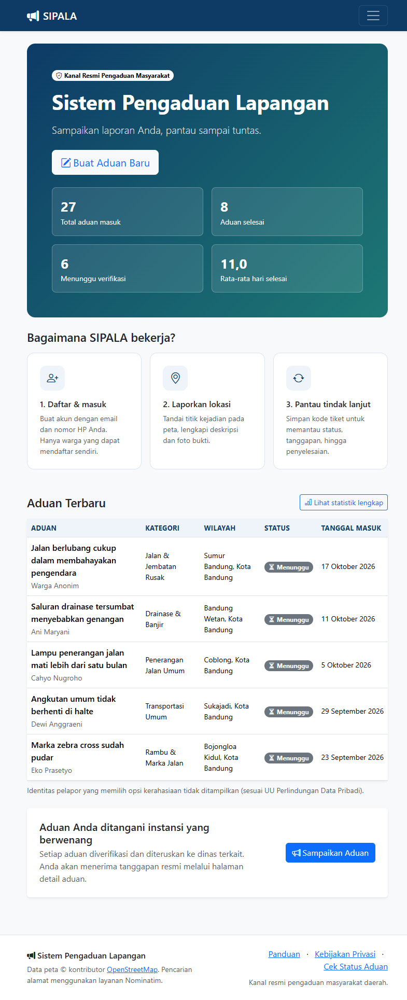 | 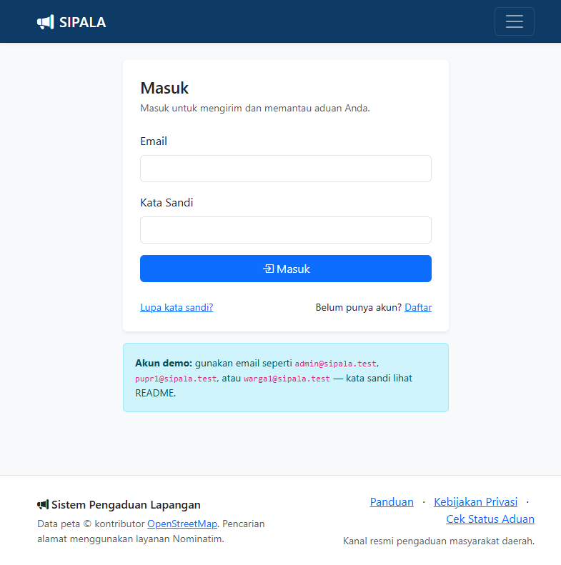 |
| **Beranda** | **Masuk** |
| 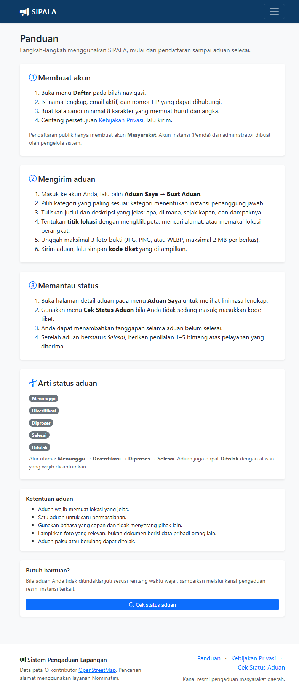 | 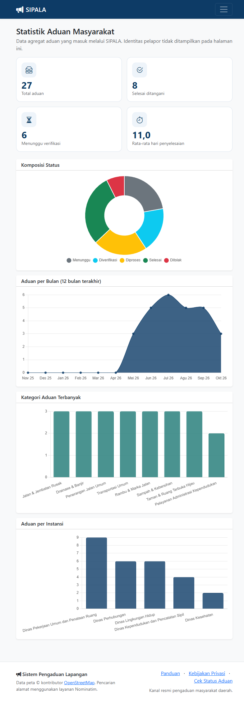 |
| **Panduan** | **Statistik publik** |

| Masyarakat | |
| --- | --- |
| 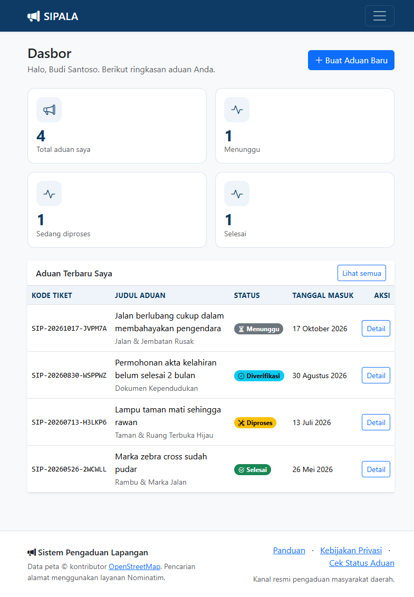 | 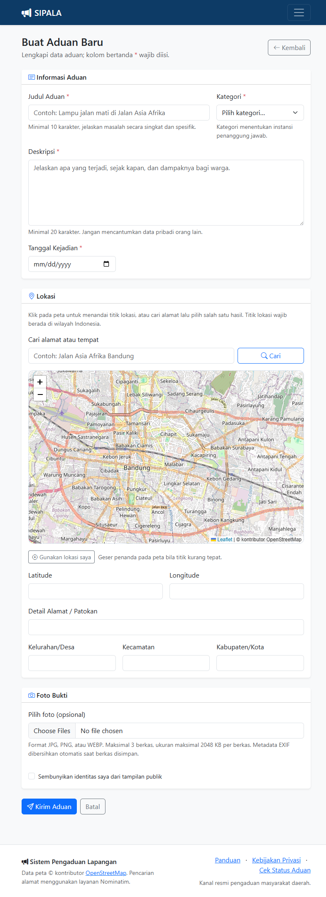 |
| **Dasbor** | **Buat aduan** |
| 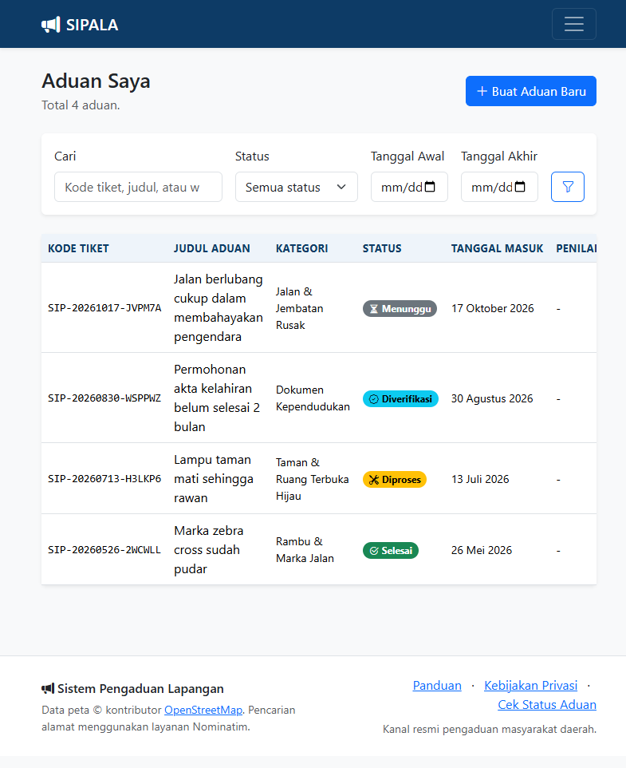 | |
| **Aduan Saya** | |

| Pemda | |
| --- | --- |
| 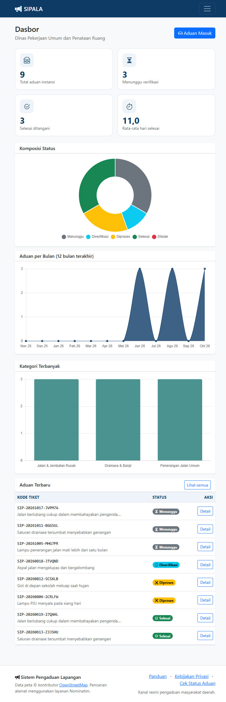 | 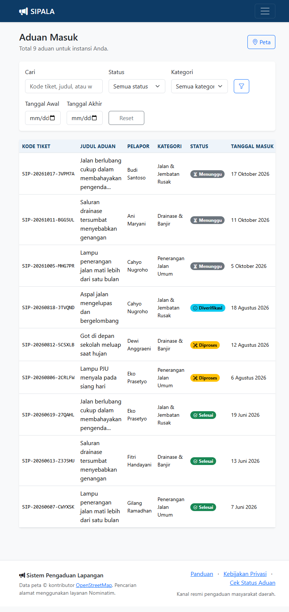 |
| **Dasbor instansi** | **Aduan Masuk** |
| 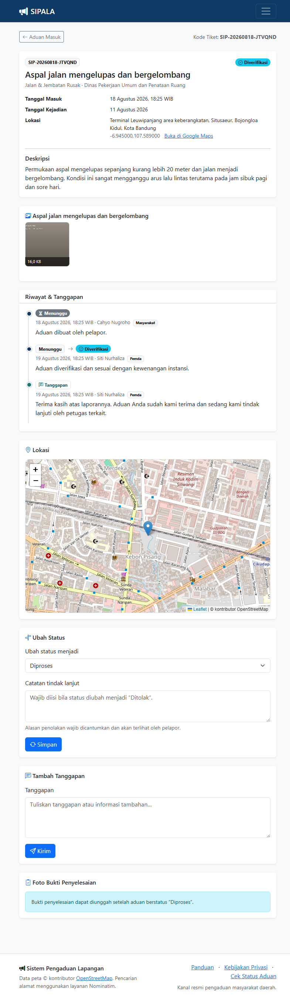 | |
| **Detail aduan & tindak lanjut** | |

| Admin | |
| --- | --- |
| 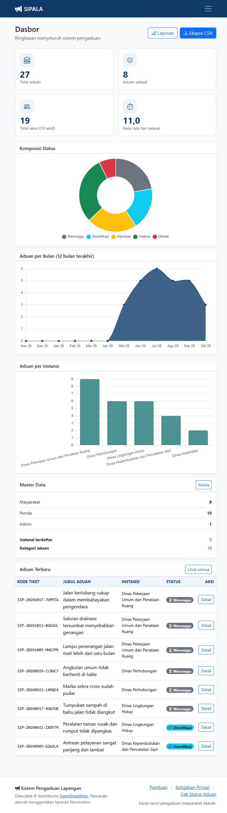 | 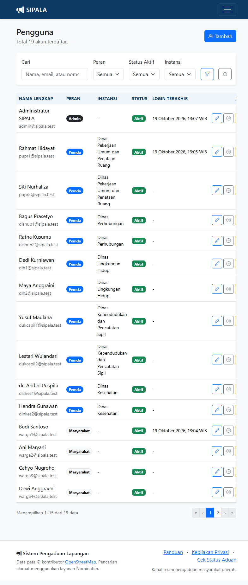 |
| **Dasbor menyeluruh** | **Manajemen pengguna** |
| 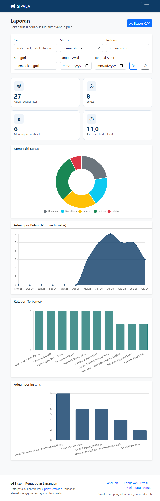 | 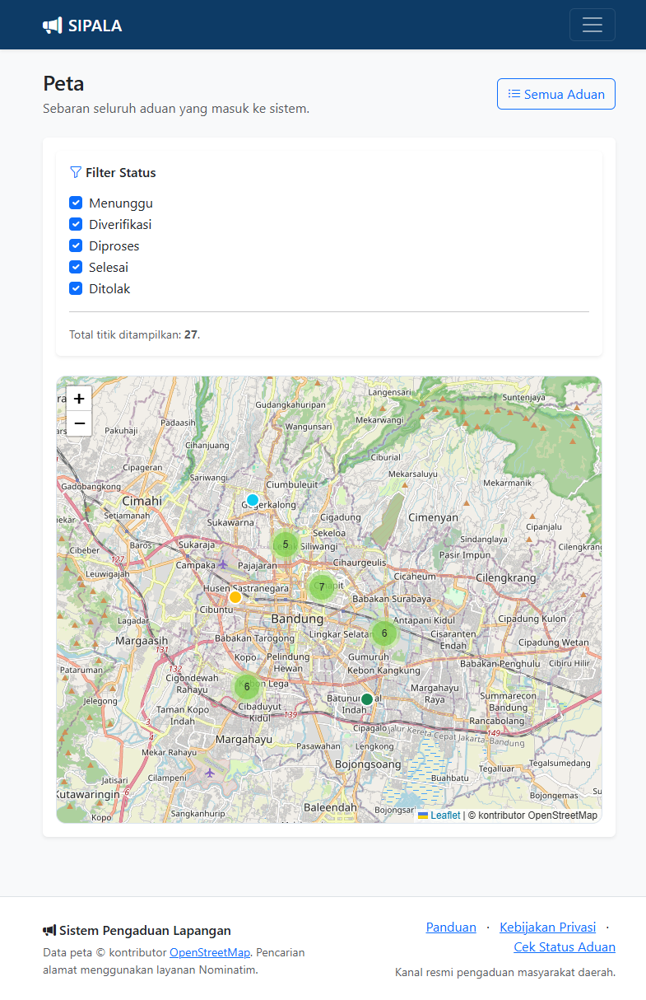 |
| **Laporan & rekapitulasi** | **Peta sebaran aduan** |
